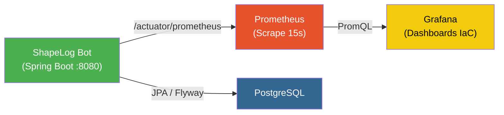
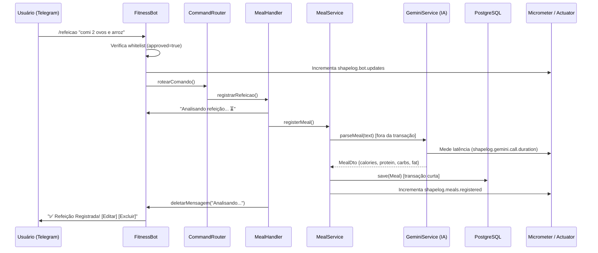

<div align="center">

# 🏋️‍♂️ ShapeLog.ai

**Assistente inteligente de nutrição e treinos via Telegram, alimentado por IA generativa e equipado com Observabilidade completa em tempo real.**

[](https://github.com/Savio-Marques/ShapeLog.ai/actions/workflows/deploy.yml)
[](https://openjdk.org/)
[](https://spring.io/projects/spring-boot)
[](https://prometheus.io/)
[](https://grafana.com/)
[](https://www.docker.com/)
[](./src/test)
[](./LICENSE)

</div>

---

## 📌 Sobre o Projeto

O **ShapeLog.ai** é um bot para o Telegram que utiliza a IA generativa do **Google Gemini 3.5 Flash Lite** (modelo padrão `gemini-3.5-flash-lite`, configurável via `GEMINI_MODEL`, via Spring AI) para processar relatos de alimentação, treinos (musculação, cardio, corrida, CrossFit, Hyrox e outras modalidades) e metas nutricionais em **texto e áudio**, estruturando automaticamente os dados em um banco PostgreSQL com migrações versionadas via Flyway.

O projeto foi construído com foco em **qualidade de código**, **segurança**, **observabilidade avançada** e **práticas de produção reais**:
- Pipeline CI/CD automatizado com GitHub Actions, build multi-arch otimizado, sync de infraestrutura, deploy por SHA imutável, health check e rollback automático.
- Stack de **Observabilidade (Prometheus + Grafana)** com métricas customizadas de negócio, pool HikariCP e infraestrutura.
- Provisionamento automatizado de dashboards via **Infrastructure as Code (IaC)**.
- Migrações versionadas com **Flyway** (`ddl-auto=validate` em produção) e Optimistic Locking (`@Version`).
- Execução assíncrona isolada por `chatId`, pool dedicado para chamadas de IA fora de transações e suíte de testes unitários e de integração (`@SpringBootTest`).

---

## ✨ Funcionalidades

| Funcionalidade | Descrição |
|---|---|
| 🎙️ **Entrada por Áudio** | Grave um áudio relatando sua refeição, treino ou meta — a IA transcreve e estrutura os dados |
| 📝 **Entrada por Texto** | Descreva em linguagem natural o que comeu ou treinou (com confirmação rápida em 1 toque quando enviado sem comando) |
| 🥗 **Registro de Refeições** | Extrai calorias, proteínas, carboidratos, gorduras, estimativa de pesos e exibe barra de progresso diária |
| 🏋️‍♂️ **Registro de Treinos** | Suporta musculação (séries/cargas individuais) e outras modalidades (cardio, corrida, CrossFit, Hyrox) |
| 📊 **Relatório Diário** | Progresso completo do dia com navegação entre datas (`/relatorio`, ontem ou `DD/MM/AAAA`) e modo gerenciar |
| 🎯 **Metas Personalizadas** | Consulte `/meta`, informe valores diretos ou descreva seu objetivo para cálculo assistido pela IA |
| ✏️ **Edição Contextual** | Edite ou exclua refeições e exercícios inline diretamente no card |
| 🔐 **Whitelist Dinâmica** | Admin aprova/revoga usuários via Telegram com cooldown nas notificações de acesso negado |
| 📈 **Observabilidade & Métricas** | Monitoramento em tempo real com **Prometheus + Grafana** e métricas customizadas |

---

## 📊 Observabilidade & Monitoramento (Prometheus + Grafana)

O **ShapeLog.ai** possui infraestrutura completa de observabilidade baseada no ecossistema Open Source **Micrometer + Prometheus + Grafana**.



### 🎯 Métricas Customizadas Instrumentadas (Micrometer)

| Métrica Prometheus | Tipo | Descrição / Rótulos |
|---|---|---|
| `shapelog_bot_updates_total` | Counter | Total de updates recebidos agrupados por tipo (`message`, `voice`, `callback`, `other`) |
| `shapelog_bot_errors_total` | Counter | Total de erros/exceções capturados no bot |
| `shapelog_bot_update_duration_seconds` | Timer | Latência de processamento dos updates do Telegram |
| `shapelog_gemini_calls_total` | Counter | Chamadas enviadas para a IA agrupadas por tipo (`meal`, `workout`, `goal`) |
| `shapelog_gemini_call_duration_seconds` | Timer | Latência de resposta da IA Google Gemini |
| `shapelog_gemini_errors_total` | Counter | Falhas ou timeouts em chamadas à IA |
| `shapelog_meals_registered_total` | Counter | Refeições extraídas e salvas com sucesso no PostgreSQL |
| `shapelog_workouts_total` | Counter | Treinos criados com sucesso no PostgreSQL |
| `hikaricp_connections_*` | Gauge | Conexões ativas, ociosas e limite máximo do pool PostgreSQL |
| `jvm_memory_used_bytes` | Gauge | Consumo de memória Heap/Non-Heap da JVM |
| `process_cpu_usage` | Gauge | Percentual de uso de CPU do container |

---

### 🎨 Dashboard Provisionado (Infrastructure as Code)

O Grafana é provisionado automaticamente a partir de [`monitoring/grafana/`](./monitoring/grafana/), com atualização contínua:

- **Datasource Provisioning**: Conexão automática com o Prometheus (`http://prometheus:9090`).
- **Dashboard Provisioning**: Auto-load do dashboard [`ShapeLog Overview`](./monitoring/grafana/dashboards/shapelog-overview.json) contendo **10 painéis interativos** (updates, erros, refeições, treinos, CPU, uptime, duração Gemini, heap JVM, chamadas/erros Gemini por tipo e pool HikariCP).

---

### 🔐 Acesso Seguro (Zero-Trust Production)

Em produção na VPS, a porta do Actuator (`8080`) e o PostgreSQL (`5432`) ficam restritos à rede interna Docker (`shapelog-net`), Prometheus escuta apenas em `127.0.0.1:9090` e o Grafana pode ser vinculado ao IP privado da Tailscale (`GRAFANA_BIND_HOST`) ou acessado via túnel SSH:

```bash
# Túnel SSH alternativo conectando a porta 3000 local ao Grafana na VPS
ssh -L 3000:localhost:3000 ubuntu@IP_DA_VPS
```

---

## 📱 Screenshots

| Registro de Refeição via Áudio | Registro de Treino | Relatório Diário |
| :---: | :---: | :---: |
|  |  |  |

---

## 🏗️ Arquitetura do Projeto

```
com.bot.telegram/
├── bot/                  ← FitnessBot (assíncrono por chatId), CommandRouter, StateManager
│   ├── handler/          ← Orquestração de fluxo (MealHandler, WorkoutHandler, GoalHandler, ReportHandler)
│   └── keyboard/         ← Fábrica de botões inline (InlineKeyboardFactory)
├── config/               ← Configurações Spring (TelegramConfig + ThreadPools, MetricsConfig)
├── formatter/            ← Camada de apresentação (MessageFormatter — MarkdownV2)
├── service/              ← Regras de negócio (MealService, WorkoutService, GeminiService, UserService, ReportService)
├── model/                ← Entidades JPA (UserTelegram, Meal, WorkoutSession)
├── dto/                  ← Objetos de transferência (MealDto, WorkoutDto, GoalDto, DailyReportDto)
└── repository/           ← Spring Data JPA Repositories com consultas por ownership
```

### Fluxo de uma Mensagem



---

## 🛠️ Stack Tecnológica

| Camada | Tecnologia |
|---|---|
| **Linguagem** | Java 17 |
| **Framework** | Spring Boot 4.1 |
| **Inteligência Artificial** | Spring AI + Google Gemini 3.5 Flash Lite (Google AI Studio) |
| **Migrações & Banco** | PostgreSQL 15 + Flyway + Spring Data JPA / Hibernate (`validate`) |
| **Observabilidade** | Spring Boot Actuator + Micrometer + Prometheus (`v3.14.0`) + Grafana (`13.2.0`) |
| **Bot API** | TelegramBots 6.8 |
| **Conteinerização** | Docker + Docker Compose |
| **CI/CD** | GitHub Actions |
| **Nuvem** | Oracle Cloud Infrastructure (OCI) — ARM64 |
| **Testes** | JUnit 5 + Mockito + Spring Boot Test + H2 |

---

## ⚙️ CI/CD Pipeline

A cada `git push` na branch `main`, o pipeline em [`.github/workflows/deploy.yml`](./.github/workflows/deploy.yml) executa automaticamente:

```
git push main
      │
      ▼
┌─────────────────────────────────────────┐
│  1. 🧪 Roda 107 Testes (JUnit + Context)│ ← Se falhar, deploy é cancelado
│  2. 🐳 Build ARM64 (estágio Maven nativo)│
│  3. 📦 Push → Docker Hub (latest + SHA) │
│  4. 📁 Sync compose + monitoring → VPS  │
│  5. 🔑 Deploy por SHA + Healthcheck     │ ← Rollback se /readiness falhar
└─────────────────────────────────────────┘
```

---

## 🚀 Como Rodar Localmente

### Pré-requisitos
- Java 17+
- Docker Desktop
- API Key gratuita no Google AI Studio ([aistudio.google.com](https://aistudio.google.com/apikey))
- Bot criado no Telegram via [@BotFather](https://t.me/BotFather)

### 1. Clone o repositório
```bash
git clone https://github.com/Savio-Marques/ShapeLog.ai.git
cd ShapeLog.ai
```

### 2. Configure as variáveis de ambiente

Crie um arquivo `.env` na raiz do projeto (nunca commite este arquivo):

```env
# Telegram
TELEGRAM_BOT_TOKEN=seu_token_aqui
TELEGRAM_BOT_USERNAME=seu_bot_username
TELEGRAM_BOT_ADMIN_ID=seu_id_telegram

# PostgreSQL
POSTGRES_DB=shapelog
POSTGRES_USER=shapelog_user
POSTGRES_PASSWORD=sua_senha_aqui
DB_URL=jdbc:postgresql://localhost:5432/shapelog
DB_USERNAME=shapelog_user
DB_PASSWORD=sua_senha_aqui

# Google AI Studio
GEMINI_API_KEY=sua_api_key_aqui
GEMINI_MODEL=gemini-3.5-flash-lite

# Grafana
GRAFANA_ADMIN_PASSWORD=sua_senha_forte_aqui
```

### 3. Suba o ambiente Docker Dev (PostgreSQL, Prometheus e Grafana)
```bash
docker compose -f docker-compose.dev.yml up -d
```

### 4. Inicie a aplicação
```bash
./mvnw spring-boot:run -Dspring-boot.run.profiles=dev
```

### 5. Acessar o Monitoramento Local
- **Actuator Health/Prometheus**: `http://localhost:8080/actuator/health` e `http://localhost:8080/actuator/prometheus`
- **Prometheus Targets**: `http://localhost:9090/targets`
- **Grafana Dashboard**: `http://localhost:3000` (em `docker-compose.dev.yml`: `admin` / `admin`)

---

## 🧪 Testes

```bash
./mvnw test
```

**107 testes automatizados** organizados por camada:

| Classe de Teste | Tipo | Qtd |
|---|---|---|
| `CommandRouterTest` | Unitário (Mockito) | 31 |
| `WorkoutServiceTest` | Unitário (Mockito) | 23 |
| `MessageFormatterTest` | Unitário (Mockito) | 15 |
| `StateManagerTest` | Unitário (Puro) | 8 |
| `MealServiceTest` | Unitário (Mockito) | 7 |
| `UserServiceTest` | Unitário (Mockito) | 7 |
| `FitnessBotTest` | Unitário / Concorrência | 4 |
| `GoalHandlerTest` | Unitário (Mockito) | 3 |
| `ReportServiceTest` | Unitário (Mockito) | 3 |
| `GeminiServiceTest` | Unitário (Mockito) | 3 |
| `MealHandlerTest` | Unitário (Mockito) | 2 |
| `TelegramApplicationTests` | Integração (`@SpringBootTest`) | 1 |

---

## 💬 Comandos do Bot

### Comandos Gerais

| Comando | Descrição |
|---|---|
| `/start` | Exibe o menu de boas-vindas com todos os comandos |
| `/refeicao <descrição>` | Registra uma refeição (ou só `/refeicao` para aguardar áudio/texto) |
| `/treino <título>` | Inicia um treino ou registra diretamente se já contiver exercício/métrica |
| `/exercicio <descrição>` | Adiciona exercícios ao treino do dia (cria automaticamente se não houver) |
| `/meta` | Consulta metas atuais ou informa novos valores/objetivo para cálculo por IA |
| `/relatorio` | Gera o relatório do dia atual (`/relatorio ontem` ou `/relatorio DD/MM/AAAA`) |

### Comandos de Administrador

| Comando | Descrição |
|---|---|
| `/aprovar <ID>` | Aprova um usuário na whitelist e notifica ele |
| `/revogar <ID>` | Remove o acesso de um usuário |
| `/usuarios` | Lista todos os usuários aprovados |

---

## 🔐 Segurança

- **Whitelist dinâmica** no banco de dados com cooldown (24h) para notificações ao administrador
- **Autorização de recursos no repositório** (`findByIdAndUserId`) — cada usuário só edita/exclui seus próprios registros
- **Zero-Trust Network** — Actuator (`8080`) e banco (`5432`) isolados na rede Docker interna; Prometheus em `127.0.0.1` e Grafana restrito por bind/túnel SSH
- **Credenciais protegidas** — nenhuma credencial hardcoded; `GRAFANA_ADMIN_PASSWORD` obrigatória em produção
- **Container não-root & limites de recursos** — aplicação executa com usuário `spring`, healthcheck e limites explícitos de RAM/CPU
- **Proteção contra payloads abusivos** — limite de 2 minutos / 2 MB em mensagens de voz antes do download

---

## 📁 Estrutura do Deploy na VPS

```
/home/ubuntu/shapelog-bot/
├── docker-compose.yml            ← Orquestra Bot, Postgres, Prometheus e Grafana
├── .env                          ← Variáveis de ambiente (não versionado)
└── monitoring/                   ← Configurações e Dashboards do Prometheus + Grafana (IaC)
    ├── prometheus.yml
    └── grafana/
        ├── provisioning/
        │   ├── datasources/prometheus.yml
        │   └── dashboards/dashboard.yml
        └── dashboards/shapelog-overview.json
```

---

## 👤 Autor

**Sávio Marques**

[](https://linkedin.com/in/savio-marques)
[](https://github.com/Savio-Marques)
